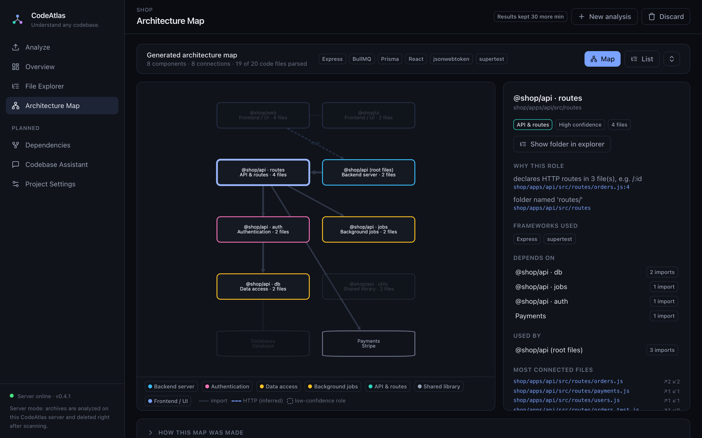
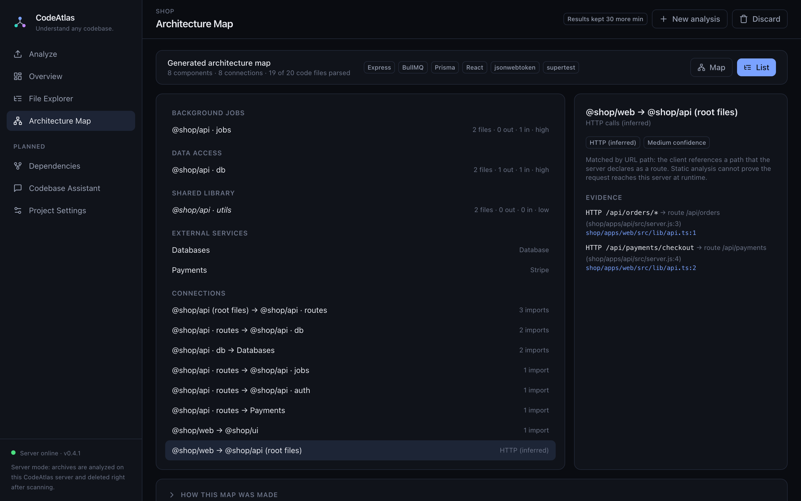
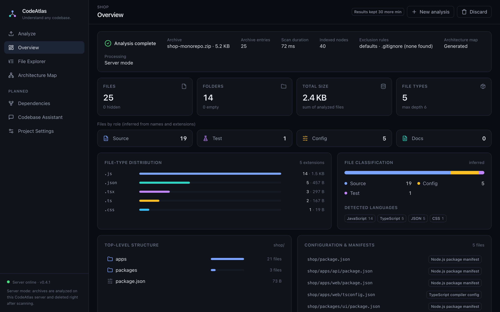
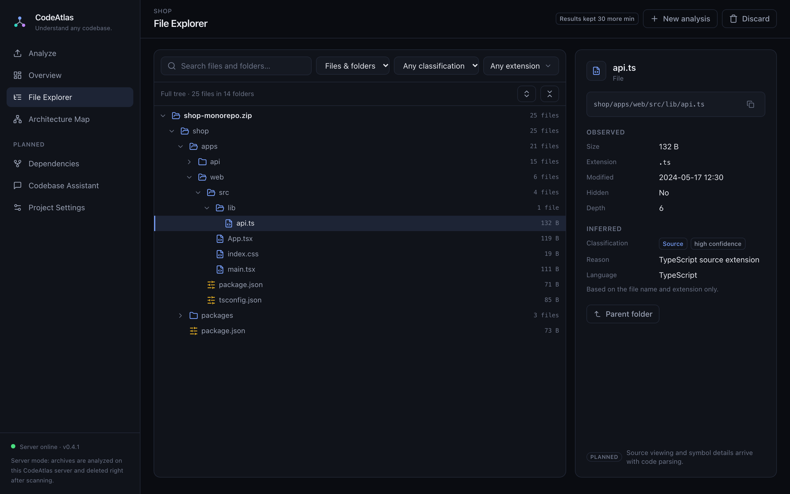
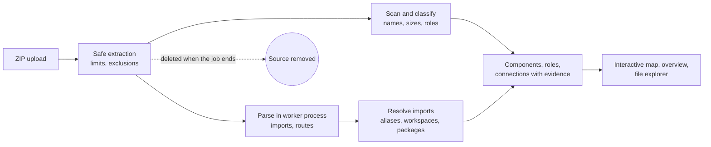

<div align="center">

# CodeAtlas

**Understand any codebase. Visualize every connection.**

Upload a project ZIP and get an interactive map of its architecture, with the evidence behind every box and arrow.

[](https://github.com/Amrittr/codeatlas/actions/workflows/ci.yml)
[](LICENSE)


</div>



## Why

When developers leave or change teams, their code stays but their understanding goes with them. The
next person has to work out what the parts are, how they connect and where to start, usually
by reading code for days. Most projects have no architecture diagram, or one that is out of date.

CodeAtlas generates that map from the code itself. It never asks you to take its word for it:
every conclusion links to the file and line it came from, and anything it can't be sure of is
labelled as a guess.

## Features

**Generated architecture map**
- Groups files into components using package boundaries and source folders.
- Infers each component's role: frontend, API, backend, business logic, data access,
  authentication, background jobs, shared library or tests.
- Connects components through real imports, parsed with [tree-sitter](https://tree-sitter.github.io/) (JS, TS, TSX) and Python's `ast`, so
  comments and strings are never mistaken for code.
- Links frontends to the APIs they call by matching URLs to declared routes, marked *inferred*.
- Shows external services: databases, payments, email, AI, cloud and messaging.
- Offers an interactive diagram and an accessible list view of the same data.



**Project overview and file explorer**
- File and folder counts, sizes, file-type and language breakdowns, config files, largest files.
- A virtualised, keyboard-accessible tree. A 100,000-file project opens in about 60 ms, and
  search returns in about 90 ms ([benchmarks](docs/TESTING.md#benchmarks)).
- Search by name or path, and filter by type, role and extension.

| Overview | File explorer |
|---|---|
|  |  |

**Control over what is analyzed**
- Respects `.gitignore` files with git's real rules, including nested files and negation.
- Skips dependency, VCS and cache folders by default, and takes your own exclude and include patterns.
- Detects generated folders (`dist/` of bundles, `target/` next to `Cargo.toml`) from evidence.
- Excluded paths stay visible in the tree, each with the exact rule that excluded it.

**Built for untrusted code**
- Uploaded code is **never executed**. It is parsed as data, in a separate process that is killed
  if a file takes too long.
- ZIP handling rejects path traversal and decompression bombs, and skips symlinks.
- Source code is deleted when analysis ends. Only metadata stays, in memory, for 30 minutes.
- Details are in [docs/SECURITY.md](docs/SECURITY.md).

## Quick start

You need Python 3.11+, Node.js 20+ and `make`.

```bash
git clone https://github.com/Amrittr/codeatlas.git
cd codeatlas
make setup     # installs pinned dependencies and builds the frontend
make dev       # serves the app on http://localhost:8000
make test      # backend (pytest) and frontend tests
make check     # syntax-checks every Python and JS source file
```

Open <http://localhost:8000> and drop in a `.zip` of any project. GitHub's **Code → Download ZIP** works
directly. Run `make sample` to create demo archives in `samples/`.

> [!WARNING]
> **Run CodeAtlas on `localhost` or a trusted network.** This release has no login: anyone who can
> reach the server can upload archives and read analyses by id.

## How it works



The backend is Python and FastAPI. The frontend is vanilla JavaScript ES modules with Tailwind
CSS and Cytoscape.js, with no framework and no bundler. See [docs/ARCHITECTURE.md](docs/ARCHITECTURE.md).

## Current limitations

CodeAtlas is early-stage, and these limits are deliberate to state plainly:

- **Languages:** imports are analyzed for JavaScript, TypeScript and Python only. Other languages
  appear in components, without connections.
- **Static analysis only:** runtime wiring such as dependency injection or service-to-service
  calls through gateways isn't proven. HTTP arrows are inferred from matching URL paths.
- **No accounts or persistence:** results live in server memory and are lost on restart.
- **Input:** ZIP uploads only, with no GitHub import yet. To change exclusion rules, upload again.
- **Tested limits:** 100 MB upload, 1 GB extracted, 100,000 files. Benchmarks used small synthetic
  files, so real repositories with large files take longer.
- **Platforms:** tested on macOS and Linux, not Windows.

## Roadmap

Planned next: more languages, function and class indexing, a file-level dependency graph,
map export, GitHub import, a codebase assistant, and a local-only agent. See
[docs/IMPLEMENTATION_PLAN.md](docs/IMPLEMENTATION_PLAN.md).

## Documentation

| Document | Contents |
|---|---|
| [Architecture](docs/ARCHITECTURE.md) | Design, data model and decisions |
| [API](docs/API.md) | Every endpoint and response |
| [Security](docs/SECURITY.md) | Threats, controls and how code is handled |
| [Testing](docs/TESTING.md) | Test suites and benchmark results |
| [Roadmap](docs/IMPLEMENTATION_PLAN.md) | Phases and status |
| [Changelog](docs/CHANGELOG.md) | Release history |

## Contributing

Bug reports, ideas and pull requests are welcome. See [CONTRIBUTING.md](CONTRIBUTING.md).
Please report security problems [privately](https://github.com/Amrittr/codeatlas/security/advisories/new).

## License

Copyright © 2026 Amrit TR. Licensed under the [GNU AGPL-3.0](LICENSE).

You can use, modify and share CodeAtlas freely. If you run a modified version as a network service,
the AGPL requires you to offer its source code to that service's users.
